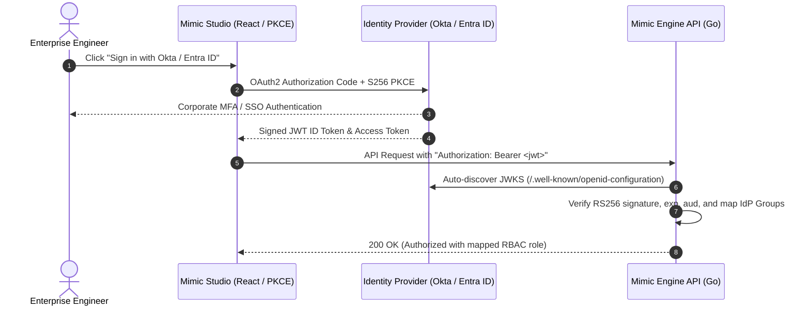

# Enterprise Single Sign-On (SSO) & RBAC Guide

OpenMimic is engineered for enterprise organizations requiring seamless integration with corporate Identity Providers (IdPs) such as **Okta**, **Microsoft Entra ID (Azure AD)**, **Google Workspace**, **Keycloak**, and **SAML 2.0 / OpenID Connect (OIDC)** federations.

---

## 🏛️ Enterprise Security Architecture

OpenMimic implements zero-trust, stateless identity verification:



---

## ⚙️ Configuration Specification (`EnterpriseSSOConfig`)

Enterprise SSO is configured at the platform or tenant level in `mimic.json` or via the **Platform Settings & Governance** tab in Mimic Studio.

### Protocol Buffers Definition
```protobuf
message EnterpriseSSOConfig {
  bool enabled = 1;
  string provider_type = 2; // "OIDC", "SAML", "OKTA", "AZURE_AD", "KEYCLOAK"
  string issuer_url = 3;    // e.g. "https://login.microsoftonline.com/{tenant_id}/v2.0"
  string client_id = 4;     // OAuth2 Client ID
  string client_secret = 5; // Secret or secret reference
  string jwks_url = 6;      // JWKS public keys URI (auto-discovered if empty)
  string redirect_uri = 7;  // Callback redirect URI
  map<string, string> group_role_mappings = 8; // Enterprise Group -> OpenMimic Role
  string default_role = 9;  // Fallback role: "viewer"
  bool enforce_pkce = 10;   // Enforce Proof Key for Code Exchange (S256)
}
```

### Sample `mimic.json` Configuration
```json
{
  "conventions": {
    "tenant_id": "tenant-corp-enterprise",
    "sso_config": {
      "enabled": true,
      "provider_type": "OKTA",
      "issuer_url": "https://techwasti.okta.com/oauth2/default",
      "client_id": "0oae9k2z45OpenMimicClient",
      "group_role_mappings": {
        "DataPlatform-Admins": "super_admin",
        "Data-Engineers": "tenant_admin",
        "Security-Auditors": "viewer"
      },
      "default_role": "viewer",
      "enforce_pkce": true
    }
  }
}
```

---

## 👥 Role-Based Access Control (RBAC) Tiers

OpenMimic maps corporate IdP claims directly into 3 authorization tiers:

| Tier | OpenMimic Role | Permissions |
| :--- | :--- | :--- |
| **Platform Administrator** | `super_admin` | Hard event & rate limits, global Kafka broker bindings, full workspace & tenant oversight. |
| **Stream Engineer** | `tenant_admin` | Design schemas, configure sinks, run/stop generators, execute DAG pipelines, and define CEP windows. |
| **Auditor / Analyst** | `viewer` | Read-only access to topologies, streaming event previews, observability metrics, and compliance audit logs. |

---

## 🔐 Cryptographic Verification Details

1. **RS256 Public Key Discovery:** The engine queries `/.well-known/openid-configuration` to discover the active `jwks_uri`.
2. **Key Rotation & Caching:** In-memory caching with on-demand key refresh when an unknown Key ID (`kid`) is encountered.
3. **Clock-Skew Leeway:** 30-second leeway buffer prevents intermittent authorization drops due to distributed clock drift.
4. **Signature Tampering Guard:** RSA PKCS#1 v1.5 verification using SHA-256 rejects modified payloads or forged assertions.

---

## 🖥️ Studio Single Sign-On (SSO) Flow

In **Mimic Studio**:
1. Click **Enterprise SSO Login** in the upper right navigation header.
2. Select your provider:
   - **Sign in with Okta**
   - **Sign in with Microsoft Entra ID (Azure AD)**
   - **Sign in with Corporate SAML / Keycloak**
3. Once authenticated, the header displays your corporate email, assigned role badge, and provider pill.

---

## 🔄 SCIM 2.0 User & Group Provisioning (RFC 7643 / RFC 7644)

OpenMimic includes a full-featured SCIM 2.0 service allowing Okta and Microsoft Entra ID to automatically provision, synchronize, and de-provision user accounts and groups:

- **Users API:**
  - `GET /scim/v2/Users` — List and paginate users.
  - `POST /scim/v2/Users` — Provision new user accounts.
  - `GET /scim/v2/Users/{id}` — Retrieve user profile.
  - `PUT /scim/v2/Users/{id}` — Update user profile and activate/deactivate accounts.
  - `DELETE /scim/v2/Users/{id}` — Offboard user account upon departure.
- **Groups API:**
  - `GET /scim/v2/Groups` — List provisioned enterprise groups.
  - `POST /scim/v2/Groups` — Create groups and manage member assignments.
- **Specification Discovery:**
  - `GET /scim/v2/ServiceProviderConfig` — Discovers supported auth schemes and capabilities.

