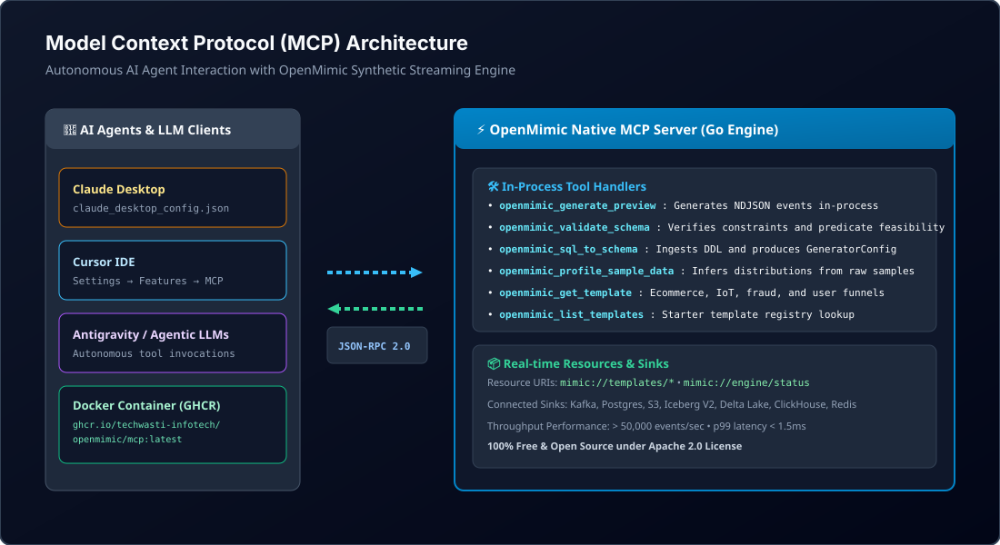

# Model Context Protocol (MCP) Server Integration 🧠




OpenMimic provides native, high-performance support for the **Model Context Protocol (MCP)** (specification version `2024-11-05`). 

By connecting OpenMimic's MCP server to your LLM client (such as **Claude Desktop**, **Cursor**, **Copilot**, **Antigravity**, or custom enterprise AI agents), your LLM gains autonomous tools to:
- 🧪 **Preview synthetic records** on-the-fly from declarative JSON / Protobuf schemas.
- ✅ **Validate schemas & constraints** (verifying data types, distributions, and predicate feasibility).
- 📜 **Convert SQL DDL (`CREATE TABLE ...`)** into ready-to-run streaming generator configurations.
- 🔍 **Reverse-engineer schemas from sample JSON records** with automatic statistical profiling (numeric distributions, categorical weights, UUID detection).
- 📦 **Fetch pre-built starter templates** (`ecommerce_order_flow`, `user_signups`, `iot_telemetry`, `financial_fraud_stream`).
- 📚 **Read live engine status and schema resources** via URI schemes like `mimic://templates/{name}` and `mimic://engine/status`.

---

## ⚡ Quick Start: Running the Server

OpenMimic ships the MCP server directly within the Go CLI binary (`mimic mcp`) as well as a standalone binary (`mimic-mcp`). It communicates via standard JSON-RPC 2.0 over `stdio`.

### Test via CLI
```bash
# Using the main CLI:
mimic mcp

# Or using the dedicated binary:
mimic-mcp
```

Send an initialization JSON-RPC request:
```json
{"jsonrpc":"2.0","id":1,"method":"initialize","params":{}}
```

---

## 🤖 Configuring Claude Desktop

To use OpenMimic with **Claude Desktop**, add the OpenMimic MCP server to your `claude_desktop_config.json`:

- **macOS:** `~/Library/Application Support/Claude/claude_desktop_config.json`
- **Windows:** `%APPDATA%\Claude\claude_desktop_config.json`
- **Linux:** `~/.config/Claude/claude_desktop_config.json`

### Configuration Snippet

```json
{
  "mcpServers": {
    "openmimic": {
      "command": "C:\\path\\to\\OpenMimic\\engine\\bin\\mimic-mcp.exe",
      "args": ["--stdio"]
    }
  }
}
```

*(On macOS/Linux, specify the compiled Go binary path, e.g. `/usr/local/bin/mimic mcp` or `/opt/openmimic/bin/mimic-mcp`)*.

---

## 💻 Configuring Cursor IDE

Add the OpenMimic MCP server in Cursor settings:
1. Open Cursor **Settings** -> **Features** -> **MCP Servers**.
2. Click **+ Add New MCP Server**.
3. Set:
   - **Name:** `openmimic`
   - **Type:** `command`
   - **Command:** `mimic-mcp --stdio` (or `mimic mcp`)

---

## 🛠️ Available MCP Tools

| Tool Name | Arguments | Description |
|---|---|---|
| `openmimic_generate_preview` | `config_json` (string, required)<br>`count` (integer, default: 5) | Runs the high-performance Go generator engine in-process and returns sample records as formatted JSON. |
| `openmimic_validate_schema` | `config_json` (string, required)<br>`check_constraints` (bool, default: true) | Checks schema syntax and tests predicate constraint satisfiability. |
| `openmimic_sql_to_schema` | `ddl` (string, required) | Converts SQL `CREATE TABLE` statements into an OpenMimic `GeneratorConfig`. |
| `openmimic_profile_sample_data` | `samples` (string, JSON array)<br>`table_name` (string) | Infers column types, distributions (mean/stddev), categories, and null ratios from sample rows. |
| `openmimic_get_template` | `template_name` (string, enum) | Retrieves a pre-built starter configuration (`ecommerce_order_flow`, `user_signups`, `iot_telemetry`, `financial_fraud_stream`). |
| `openmimic_list_templates` | *(none)* | Returns a list of all available pre-built templates and descriptions. |

---

## 📚 MCP Resources & Prompts

### Available Resources
- `mimic://templates/ecommerce_order_flow`
- `mimic://templates/user_signups`
- `mimic://templates/iot_telemetry`
- `mimic://templates/financial_fraud_stream`
- `mimic://engine/status` (Provides engine version, active sink drivers, traffic profiles, and privacy mechanisms)

### Available Prompts
- `design_synthetic_dataset`: Guides an LLM through designing a realistic synthetic data generator for stress-testing message queues or databases.
- `convert_sql_to_generator`: Guides the conversion of relational schemas into high-throughput streaming generators.

---

## 💬 Example LLM Prompts

Once configured in your LLM, you can interact naturally:

> **User:** *"I need a synthetic dataset for testing our fraud detection pipeline. Can you fetch the OpenMimic fraud template and preview 5 events?"*

> **User:** *"Here is my PostgreSQL orders table: `CREATE TABLE orders (id UUID PRIMARY KEY, customer_id INT, amount NUMERIC(10,2), status VARCHAR(20));`. Convert this to an OpenMimic configuration and validate it."*

> **User:** *"Profile these 3 sample JSON rows from our logs and create an OpenMimic schema for them."*

---

## 🐳 Docker Container & GitHub Packages Usage

OpenMimic automatically packages and publishes Docker container images and downloadable artifacts on every release and build.

### Running via GitHub Container Registry (GHCR)
```bash
# Pull the latest OpenMimic MCP Server container
docker pull ghcr.io/techwasti-infotech/openmimic/mcp:latest

# Run the MCP container interactively over stdio
docker run -i --rm ghcr.io/techwasti-infotech/openmimic/mcp:latest
```

### Configuring Claude Desktop with Docker

If you prefer running OpenMimic MCP inside Docker rather than as a local binary, configure your `claude_desktop_config.json`:

```json
{
  "mcpServers": {
    "openmimic-docker": {
      "command": "docker",
      "args": [
        "run",
        "-i",
        "--rm",
        "ghcr.io/techwasti-infotech/openmimic/mcp:latest"
      ]
    }
  }
}
```

---

## 📥 Downloading Pre-built Artifacts from GitHub Actions

1. Navigate to the [OpenMimic GitHub Actions tab](https://github.com/Techwasti-Infotech/OpenMimic/actions).
2. Select the latest **Release OpenMimic Binaries & Docker Images** workflow run.
3. Scroll down to the **Artifacts** section to download:
   - `openmimic-windows-amd64` (Contains `mimic-mcp.exe`, `mimic-cli.exe`, `mimic.exe`)
   - `openmimic-linux-amd64` / `openmimic-linux-arm64` (Linux executable binaries)
   - `openmimic-darwin-amd64` / `openmimic-darwin-arm64` (macOS executable binaries)
   - `openmimic-mcp-docker-image` (Compressed `.tar.gz` archive containing the Docker image ready for `docker load < openmimic-mcp-docker.tar.gz`)
