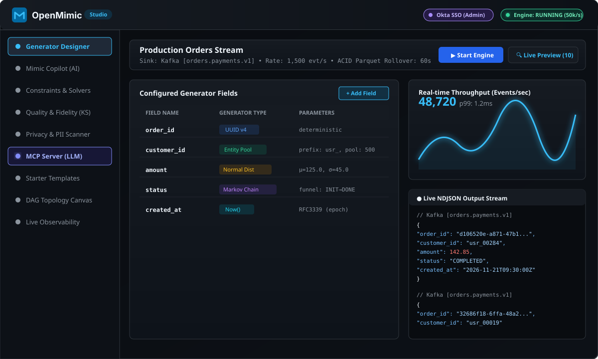

# Mimic Studio User Guide

**Mimic Studio** is the visual IDE for OpenMimic, built with React 18, Vite, and Mantine. It enables interactive design of data generation streams, live previews, statistical quality checks, DAG stream topologies, and real-time observability.

---

## 🎨 Studio Navigation & Feature Tabs

Mimic Studio provides 9 integrated workspaces accessible from the left sidebar:

1. **Generator Designer:** Build, edit, and configure schemas, distributions, and sinks (Kafka, PostgreSQL, Redis, ClickHouse, S3, Stdout).
2. **Mimic Copilot:** Interact with the natural-language generation assistant to convert plain English into validated Protocol Buffers configurations.
3. **Constraints & Solvers:** Define field and cross-field predicates (`amount > 50000 && fraud_flag == 1`). The engine evaluates candidates and resamples until all predicates are satisfied.
4. **Quality & Fidelity:** Inspect statistical fidelity metrics against reference data, including the two-sample **Kolmogorov-Smirnov test (KS test)** and **Pearson correlation coefficient**.
5. **Privacy & PII Scanner:** Proactively detect unmasked sensitive identifiers (`email`, `ssn`, `phone`, `card`) and verify deterministic masking transforms.
6. **Starter Template Library:** One-click launch production-grade blueprints (e.g. E-commerce Order Flow, Financial Fraud Stream, User Funnels).
7. **Audit Trail:** Review immutable enterprise logs tracking generator starts, stops, and schema edits.
8. **Stream Topology & DAG:** Orchestrate multi-stream directed acyclic graphs (e.g. `Users` stream emitting IDs before child `Orders` stream executes).
9. **Observability Dashboard:** Real-time throughput (events/sec), latency p99, and error dashboards powered by Recharts.

---

## 🛠️ Step-by-Step Workflow

### 1. Designing a Generator

1. Navigate to **Generator Designer**.
2. Specify the **Generator Name**, **Seed**, and **Event Limit**.
3. Choose your destination sink:
   - **Kafka:** Set topic (e.g. `user.signups`) and broker endpoints.
   - **PostgreSQL:** Configure connection string and destination table.
   - **Redis:** Choose key pattern and write mode (`SET`, `LPUSH`, `RPUSH`, `PUBLISH`, or `XADD` streams).
   - **ClickHouse:** High-throughput columnar table ingestion formatted as `JSONEachRow`.
   - **Stdout:** Formatted or raw NDJSON streaming directly to the terminal.
4. Click **Add Field** to introduce new properties:
   - `uuid`: Deterministic RFC 4122 v4 UUID.
   - `distribution`: Normal or Uniform distribution for quantitative variables (e.g. latency, risk scores, payment amounts).
   - `now`: Logical timestamp formatted as RFC3339, `epoch_ms`, or `epoch_s`.
   - `string_faker`: Contextual strings (emails, names, locations, custom regex patterns).
   - `weighted_choice`: Probabilistic branches (success vs failure ratios).
   - `entity_pool`: Relational foreign-key references to guarantee customer/device entity reuse.
   - `nested_object`: Deeply nested JSON object structures.
   - `array`: Repeating variable-length collections.
   - `media_meta`: Image, audio, and video mock metadata with checksums and storage URIs.

---

### 2. Live Preview Streaming

Before streaming live events into production message queues or databases, use the **Preview (10)** feature:
- Clicking **Preview (10)** triggers an isolated request to the Engine.
- The engine executes 10 iterations in-memory using the exact logical clock and seed configured.
- The output displays in real time on the right-hand panel as formatted JSON records.

---

### 3. Business Predicates & Constraint Solving

Switch to **Constraints & Solvers**:
- Add rules such as `risk_score > 20 && risk_score < 80` or `amount > 50000 && fraud_flag == 1`.
- Set `max_resample_retries` (default: 100).
- OpenMimic automatically discards non-conforming samples until the constraint predicate evaluates to `true`.
- Add **Anomaly Playbooks** to simulate edge cases (corrupt payloads, null fields, burst spikes) at configurable percentage rates.

---

### 4. Running & Stopping Pipelines

- Click **Run Generator** to dispatch the configuration to the OpenMimic Engine via `POST /api/generators/start`.
- The status pill in the header transitions to `Engine: RUNNING`.
- To halt stream execution at any time, click **Stop Generator**.

---

### 5. Multi-Generator DAG Orchestration

Switch to **Stream Topology & DAG**:
- View directed acyclic graph nodes (e.g., `user_signups_stream` &rarr; `orders_placed_stream`).
- Configure downstream dependency triggers and delay offsets (`delay_after_parent_ms`).
- Link upstream streams to real-time streaming CEP window rollups.
- Click **Execute Full Topology** to trigger coordinated multi-topic generation.

---

### 6. Observability & Throughput Dashboard

Switch to **Observability Dashboard**:
- **Live Throughput Gauge (EPS):** Visual velocity gauge monitoring events per second against configured capacity limits.
- **Network Egress Gauge (MB/s):** Real-time bandwidth tracking with columnar Parquet dictionary and wire codec statistics.
- **Partition Lag & DLQ Counter:** Real-time consumer lag and dead-letter queue spillover monitoring.
- **Distributed Cluster Workers:** Scale-out node table monitoring partitioned generation agents.

---

### 7. Geo Map & Hotspots

Switch to **Geo Map & Hotspots**:
- Interactive geographic projection visualizer for simulated latitude/longitude coordinates and correlated regional IP hotspots.
- Inspect spatial distribution and bounded region clusters in real time.

---

### 8. Schema Version Control & Visual Diff

Switch to **Schema Version Control**:
- **Side-by-Side Diff Inspector:** Compare fields, types, distributions, and sink definitions between releases (e.g. `v1.0.0-prod` vs `v1.2.0-rc1`) with color-coded diff tags (`ADDED`, `REMOVED`, `UNCHANGED`).
- **Git Branch Switching:** Seamlessly switch between active Git schema branches (`main`, `feature/lakehouse-ingest`, `v2-candidate`).
- **One-Click Version Tagging:** Snapshot and tag version releases with author stamps and commit messages.

---

### 9. Synthetic Camera Video Broadcaster

Switch to **Synthetic Video Broadcaster**:
- **Live Frame Player:** Real-time visual preview displaying simulated camera frame streams with burnt-in OCR timestamp timecodes.
- **Motion Patterns:** Switch between `Bouncing Object Tracking`, `SMPTE Color Calibration Bars`, and `Optical Sensor Noise`.
- **Codec & FPS Tuning:** Configure real-time frame rates (1 to 60 FPS) and MJPEG container encodings.

